# Capturas de pantalla

| Login | Perfil |
| :---: | :---: |
| 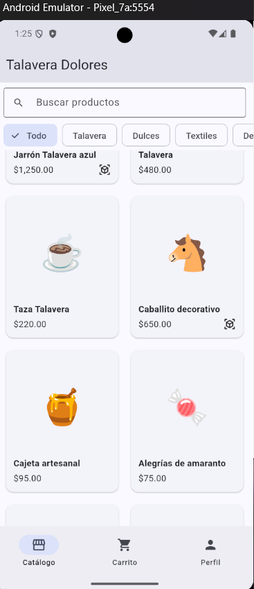 | 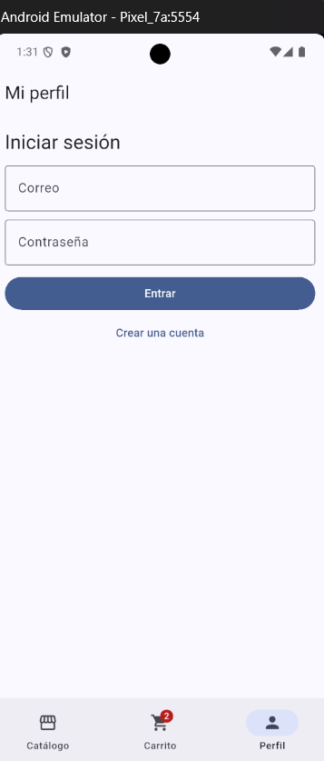 |

| Filtro decoración | Filtro textil |
| :---: | :---: |
| 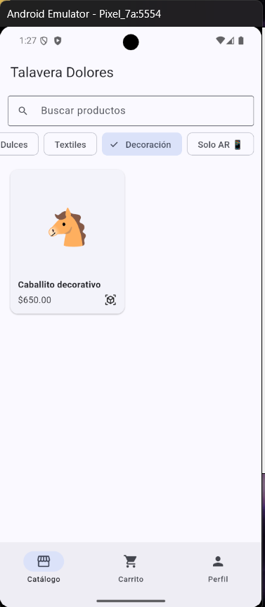 | 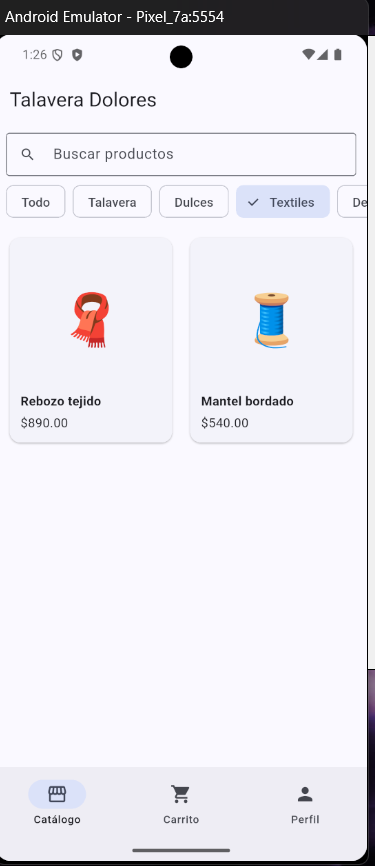 |

| Filtro dulce | Filtro talavera |
| :---: | :---: |
| 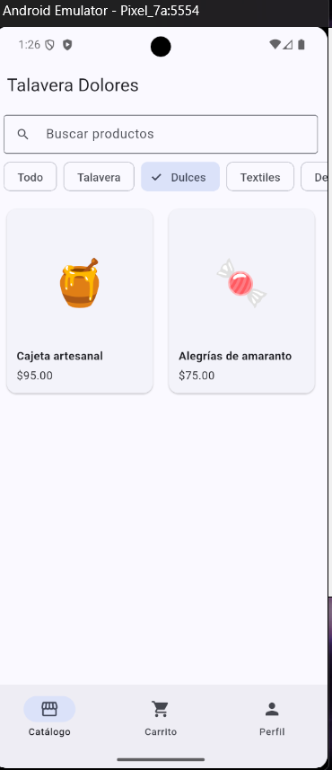 | 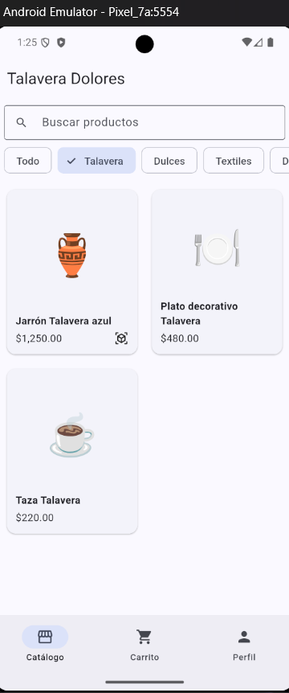 |

| Caballo 3D | Carrito |
| :---: | :---: |
| 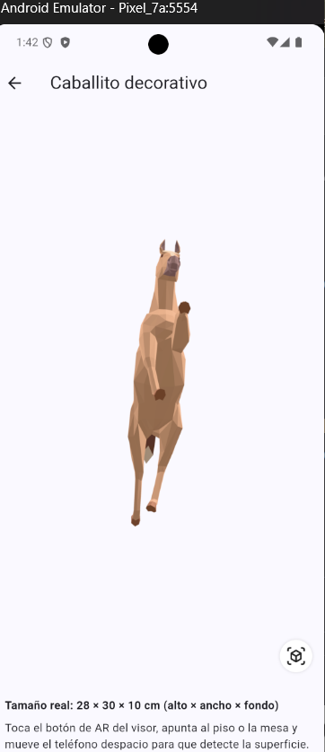 | 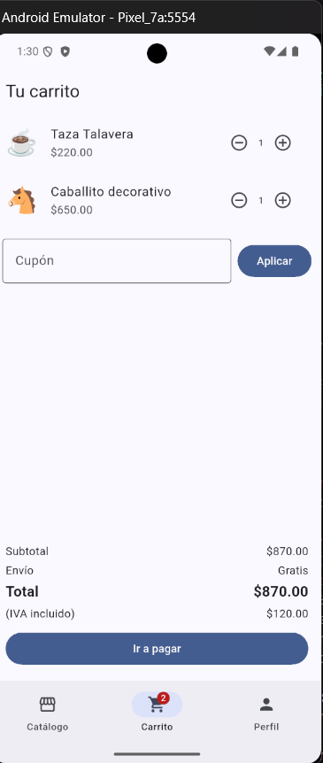 |

| Compra | Finalizar compra |
| :---: | :---: |
| 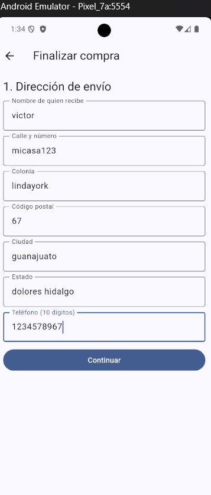 | 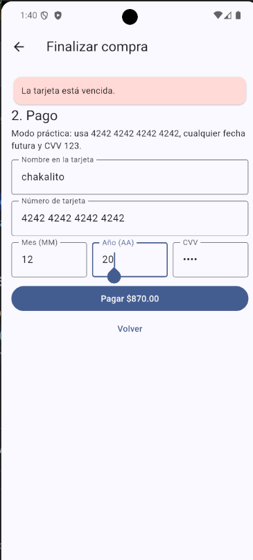 |

| Test | Test view |
| :---: | :---: |
| 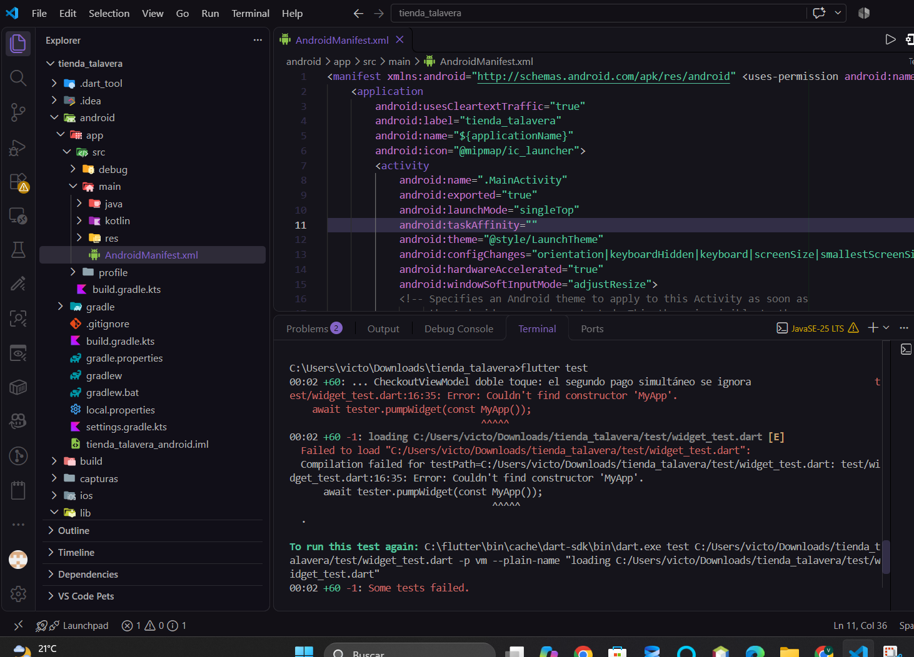 | 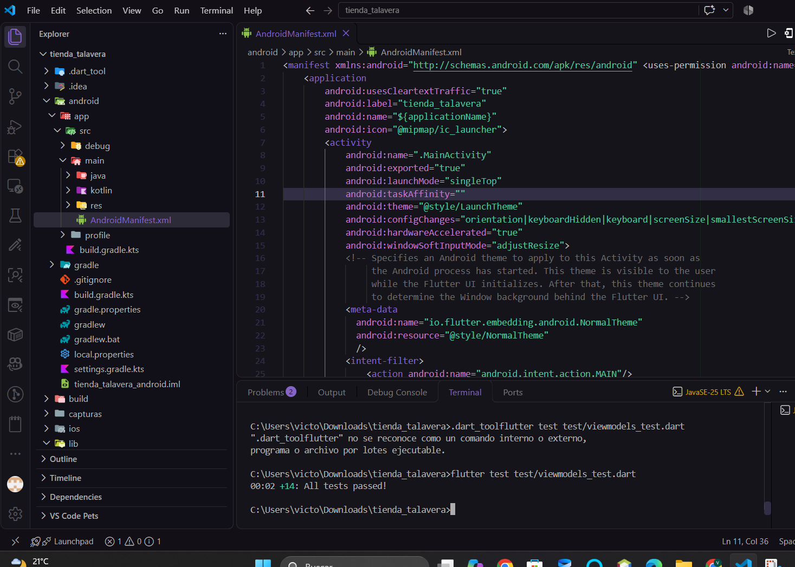 |

| Test servicio | Prueba dominio |
| :---: | :---: |
| 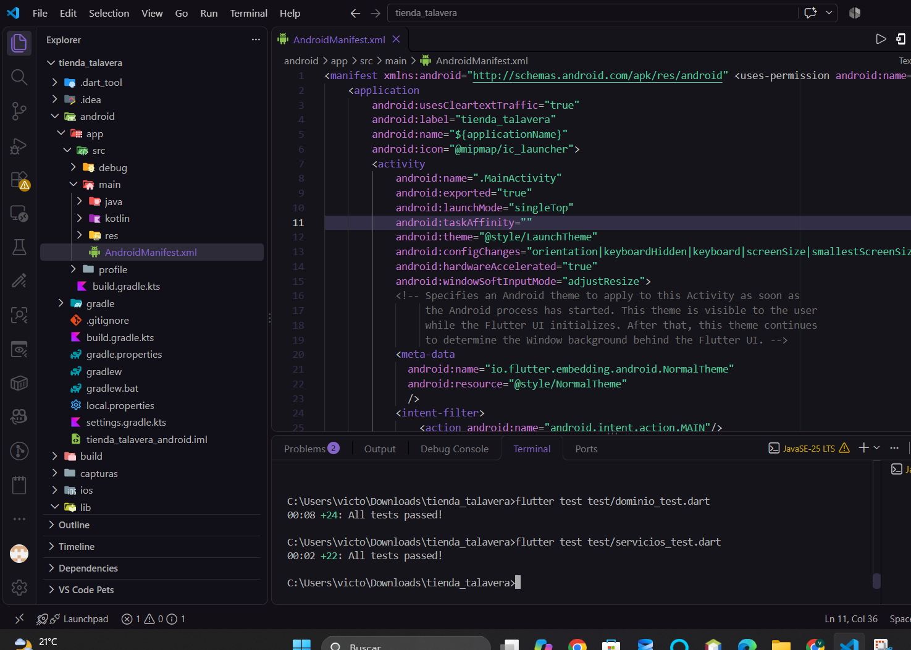 | 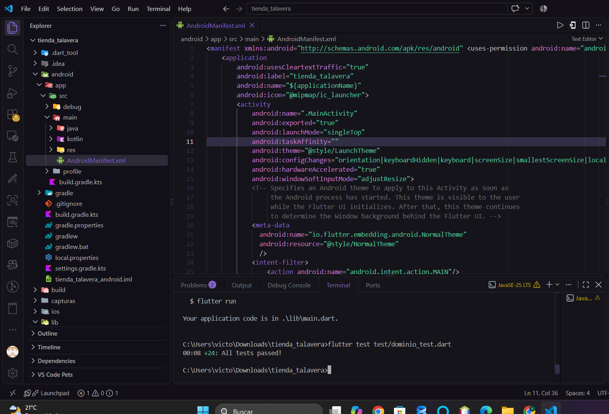 |

## Ejecución local

1. Clona el repositorio:
   ```bash
   git clone [https://github.com/vic0307/](https://github.com/vic0307/)<NOMBRE_DE_TU_REPO>.git
